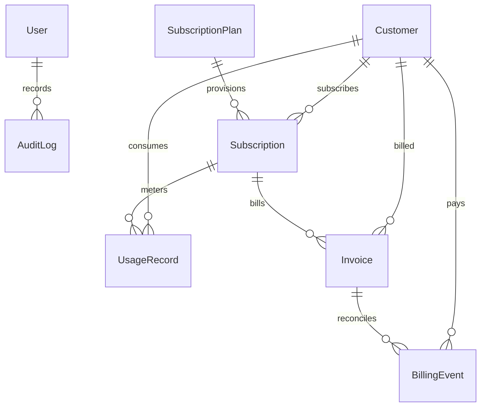

# SubscriptIQ — Enterprise Subscription Analytics & Operations SaaS MVP

[](https://nextjs.org/)
[](https://www.typescriptlang.org/)
[](https://tailwindcss.com/)
[](https://www.prisma.io/)
[](https://vitest.dev/)
[](https://opensource.org/licenses/MIT)

> **SubscriptIQ** is a full-featured, production-style Subscription Analytics and Operations SaaS MVP. Built with Next.js 14 App Router, TypeScript, Prisma ORM, and Tailwind CSS, it unifies subscription plan management, customer accounts, resource usage telemetry, simulated Stripe-like billing, role-based access control (RBAC), and database-calculated financial intelligence (MRR, ARR, Churn, LTV, ARPU).

---

## Table of Contents
1. [Project Overview & Key Capabilities](#key-capabilities)
2. [Technology Stack](#technology-stack)
3. [Architecture & Database Design](#architecture--database-design)
4. [Role-Based Access Control (RBAC)](#role-based-access-control-rbac)
5. [Demo Login Credentials](#demo-login-credentials)
6. [Quick Start & Installation](#quick-start--installation)
7. [Database Migration & Seeding](#database-migration--seeding)
8. [Automated Testing & Build Verification](#automated-testing--build-verification)
9. [REST API Reference](#rest-api-reference)
10. [Documentation Index](#documentation-index)

---

## Key Capabilities

- **Real-Time Financial Analytics Engine**: Dynamically calculates Monthly Recurring Revenue (MRR), Annual Recurring Revenue (ARR), Churn Rate, Average Revenue Per User (ARPU), and Customer Lifetime Value (LTV) from database rows across selectable date ranges (7d, 30d, 90d, 12m).
- **Interactive Recharts Visualizations**: Monthly cash revenue curves, customer acquisition vs. subscription growth cohorts, plan revenue share, and payment health indicators.
- **Subscription Lifecycle Management**: Full orchestration supporting plan creation, customer assignment, monthly and annual billing cycles, upgrades/downgrades, contract renewals, and non-destructive cancellations preserving historical audit records.
- **Resource Usage Telemetry & Quota Tracking**: Real-time meters tracking consumption across API requests, storage (MB), active users, and transactions with automated warning triggers at 80% quota and breach alerts at >100%.
- **Simulated Stripe-like Billing Engine**: Interactive payment simulator supporting successful charges, card declines (insufficient funds, expired card), and refunds. Includes a cryptographic **Idempotency Key Safeguard** that rejects duplicate transactions.
- **Strict Role-Based Access Control (RBAC)**: Backend-enforced permissions across Admin, Manager, and Support Agent roles. Support Agents are restricted from accessing sensitive financial aggregates and administrative settings.
- **Tamper-Proof Audit Trail**: Immutable append-only compliance logging capturing the actor, entity, action, and change summary for all state mutations.
- **Modern Linear/Stripe-Inspired UI**: Responsive layout with sidebar navigation, breadcrumbs, 1-click demo persona switcher, toast notifications, search, sorting, pagination, and persistent Light/Dark mode.

---

## Technology Stack

| Layer | Technologies |
| :--- | :--- |
| **Frontend Framework** | Next.js 14 (App Router, Server & Client Components) |
| **Language & Typing** | TypeScript 5.6 (Strict Type Checking) |
| **UI Styling** | Tailwind CSS 3.4 with custom CSS Theme Variables |
| **Data Visualizations** | Recharts (Area, Bar, Composed, and Pie Charts) |
| **Icons** | Lucide React |
| **Backend & API** | Next.js Route Handlers (`/api/*`), REST Architecture |
| **Validation** | Zod (Runtime Schema & Input Validation) |
| **Database & ORM** | Prisma 5.22 with Dual Configuration: SQLite (zero-config local run) & PostgreSQL (cloud production) |
| **Authentication** | Stateless Signed JWTs (`jose`), Salted Password Hashing (`bcryptjs`), Secure HTTP-only cookies |
| **Testing** | Vitest 2.1 (Unit, Integration, and DB Verification Tests) |

---

## Architecture & Database Design

SubscriptIQ manages 8 normalized relational models in Prisma:



- **Users**: Admin, Manager, and Support Agent operators with salted bcrypt password hashes.
- **Customers**: Subscriber accounts and company records.
- **SubscriptionPlans**: Tiers (Starter, Growth, Scale, Enterprise, API) with monthly/annual pricing, feature lists, and quota caps.
- **Subscriptions**: Customer-to-Plan contracts with lifecycle states (`ACTIVE`, `TRIALING`, `CANCELLED`, `PAST_DUE`, `EXPIRED`).
- **UsageRecords**: Real-time consumption telemetry across resource metrics.
- **Invoices**: Formatted invoicing statements with due dates and settlement status (`PAID`, `UNPAID`, `REFUNDED`).
- **BillingEvents**: Simulated Stripe-like payment events with unique `idempotencyKey` constraints.
- **AuditLogs**: Immutable audit entries capturing system mutations.

---

## Role-Based Access Control (RBAC)

| Operational Capability | Admin (`ADMIN`) | Manager (`MANAGER`) | Support Agent (`SUPPORT_AGENT`) |
| :--- | :---: | :---: | :---: |
| **Executive Financial Metrics (MRR, ARR, LTV)** | Full Access | Full Access | **Masked ("Confidential")** |
| **Plan Management (Create, Edit, Delete)** | Full CRUD | Read-Only | Read-Only |
| **Plan Deletion Dependency Check** | Enforced | N/A | N/A |
| **Customer Management** | Full CRUD | Create, Read, Edit | Read & Edit Contact Info |
| **Customer Deletion** | Allowed | Denied | Denied |
| **Subscription Lifecycle (Upgrade, Cancel, Renew)** | Allowed | Allowed | Read-Only |
| **Usage Telemetry Ingestion** | Allowed | Allowed | Read-Only |
| **Stripe Payment Simulator** | Full Access | Denied | Denied |
| **Compliance Audit Trail** | Full Access | Full Access | **Hidden & Forbidden** |
| **CSV Financial Export** | Allowed | Allowed | Denied |

---

## Demo Login Credentials

For local development and evaluator review, the database is pre-seeded with three demo personas. The login page (`/login`) also includes **1-Click Demo Buttons** to sign in instantly without typing:

| Role | Name | Email | Password | Permissions Summary |
| :--- | :--- | :--- | :--- | :--- |
| **Administrator** | Alexandra Vance | `admin@subscriptiq.com` | `Admin123!` | Complete administrative authority, plan CRUD, payment simulator, audit logs. |
| **Manager** | Marcus Reynolds | `manager@subscriptiq.com` | `Manager123!` | Executive analytics, customer management, subscriptions, cannot delete plans. |
| **Support Agent** | Elena Rostova | `support@subscriptiq.com` | `Support123!` | Customer account lookup and billing history; financial metrics are masked. |

---

## Quick Start & Installation

### Prerequisites
- Node.js v18.17+ or v20+ (Node v22 verified)
- npm v9+

### 1. Clone & Install Dependencies
```bash
git clone <repository-url>
cd ESRS
npm install
```

### 2. Environment Setup
The project includes a `.env` pre-configured for instant zero-configuration local execution with SQLite:
```bash
# .env
DATABASE_URL="file:./dev.db"
JWT_SECRET="subscriptiq_super_secret_jwt_key_at_least_32_chars_long_2026"
NEXT_PUBLIC_APP_URL="http://localhost:3000"
NODE_ENV="development"
```

### 3. Initialize Database & Seed Sample Dataset
Execute the all-in-one database initialization script:
```bash
npm run db:setup
```
*This command executes `prisma db push`, generates the Prisma Client, and seeds 3 users, 6 plans, 35 customers, 45 subscriptions, 140 usage records, and 249 billing events.*

### 4. Run the Development Server
```bash
npm run dev
```
Open **[http://localhost:3000](http://localhost:3000)** in your browser.

---

## Database Migration & Seeding

- **Push Schema**: `npm run db:push`
- **Regenerate Prisma Client**: `npm run db:generate`
- **Re-seed Sample Data**: `npm run db:seed`
- **Production PostgreSQL Deployment**:
  To deploy with Neon, Supabase, or AWS RDS, update `DATABASE_URL` with your postgres connection string and push the postgres schema:
  ```bash
  npx prisma db push --schema=prisma/schema.postgresql.prisma
  ```

---

## Automated Testing & Build Verification

SubscriptIQ includes automated Vitest test suites verifying unit calculations, schema validations, authentication, and database constraints.

### Run Automated Tests
```bash
npm test
```
**Test Results**: **20 passed, 0 failed (100% pass rate)**.
- `tests/calculations.test.ts` (MRR, ARR, Churn Rate, LTV, Success Rate)
- `tests/validation.test.ts` (Zod schemas, negative pricing, invalid emails)
- `tests/auth-rbac.test.ts` (Bcrypt password hashing, signed JWTs, permission matrix)
- `tests/database-crud.test.ts` (Live Prisma queries, dependency checks, duplicate idempotency key rejection)

### Run Production Build
```bash
npm run build
```
Compiles and statically generates all 29 routes with 0 TypeScript or linting errors.

---

## REST API Reference

| Method | Endpoint | Description | Role Required |
| :--- | :--- | :--- | :--- |
| `POST` | `/api/auth/login` | Authenticate user & issue secure session cookie | Public |
| `POST` | `/api/auth/logout` | Terminate active session | Authenticated |
| `GET` | `/api/auth/me` | Current authenticated session identity | Authenticated |
| `GET` | `/api/dashboard/summary` | Real-time calculated KPI metrics & recent invoices | All (Masked for Support) |
| `GET` | `/api/dashboard/revenue` | Monthly revenue timeline & plan contribution | Admin, Manager |
| `GET` | `/api/dashboard/subscriptions` | Acquisition cohorts & status distribution | Admin, Manager |
| `GET` | `/api/plans` | List subscription plans with subscriber counts | All |
| `POST` | `/api/plans` | Create a new subscription plan | Admin only |
| `PUT` | `/api/plans/:id` | Update an existing subscription plan | Admin only |
| `DELETE` | `/api/plans/:id` | Delete plan (blocked if subscribers exist) | Admin only |
| `GET` | `/api/customers` | Search, filter, and paginate customer directory | All |
| `POST` | `/api/customers` | Add a new customer account | Admin, Manager |
| `GET` | `/api/customers/:id` | Customer profile, subs, billing, and usage history | All |
| `PUT` | `/api/customers/:id` | Update customer account details | All |
| `DELETE` | `/api/customers/:id` | Delete customer account | Admin only |
| `GET` | `/api/subscriptions` | List subscriptions with status filters | All |
| `POST` | `/api/subscriptions` | Assign plan and create customer subscription | Admin, Manager |
| `PUT` | `/api/subscriptions/:id` | Upgrade/downgrade subscription plan | Admin, Manager |
| `POST` | `/api/subscriptions/:id/cancel` | Non-destructive cancellation | Admin, Manager |
| `POST` | `/api/subscriptions/:id/renew` | Renew contract & advance renewal date | Admin, Manager |
| `GET` | `/api/usage` | Resource consumption logs & quota health meters | All |
| `POST` | `/api/usage` | Ingest resource usage telemetry event | Admin, Manager |
| `GET` | `/api/billing` | Invoice statements and payment events history | All |
| `POST` | `/api/billing/events` | Stripe-like payment simulator (idempotency-guarded) | Admin only |
| `GET` | `/api/analytics/revenue` | 12-month MRR & revenue trends, ARPU, MoM growth | Admin, Manager |
| `GET` | `/api/analytics/churn` | Customer churn rate timeline & tenure audit | Admin, Manager |
| `GET` | `/api/analytics/export` | Download CSV reports (Customers, Subs, Invoices) | Admin, Manager |
| `GET` | `/api/audit-logs` | Compliance audit trail with entity/action filters | Admin, Manager |

---

## Documentation Index

Comprehensive technical documentation is organized in the [`docs/`](./docs) directory:

- [**01. Problem Statement & Stakeholders**](./docs/01-Problem-Statement.md)
- [**02. Software Requirements Specification**](./docs/02-Requirements.md)
- [**03. System Architecture & Component Design**](./docs/03-System-Architecture.md)
- [**04. Database Design & Entity-Relationship Model**](./docs/04-Database-Design.md)
- [**05. Complete API Reference Documentation**](./docs/05-API-Documentation.md)
- [**06. Quality Assurance & Test Validation Evidence**](./docs/06-Testing-and-Validation.md)
- [**07. Security, Privacy & Risk Mitigation**](./docs/07-Security-and-Risk.md)
- [**08. Limitations, Trade-Offs & Future Scope**](./docs/08-Limitations-and-Future-Scope.md)
- [**09. Production Deployment Guide (Vercel & Neon)**](./docs/09-Deployment-Guide.md)
- [**10. Final Project Evaluation Report**](./docs/10-Project-Report.md)
- [**Interactive Demo Script**](./docs/DEMO-SCRIPT.md)
- [**Final Presentation Slide Outline**](./docs/PRESENTATION-OUTLINE.md)

---

## License

This project is licensed under the MIT License. Developed for software engineering internship portfolio evaluation.
