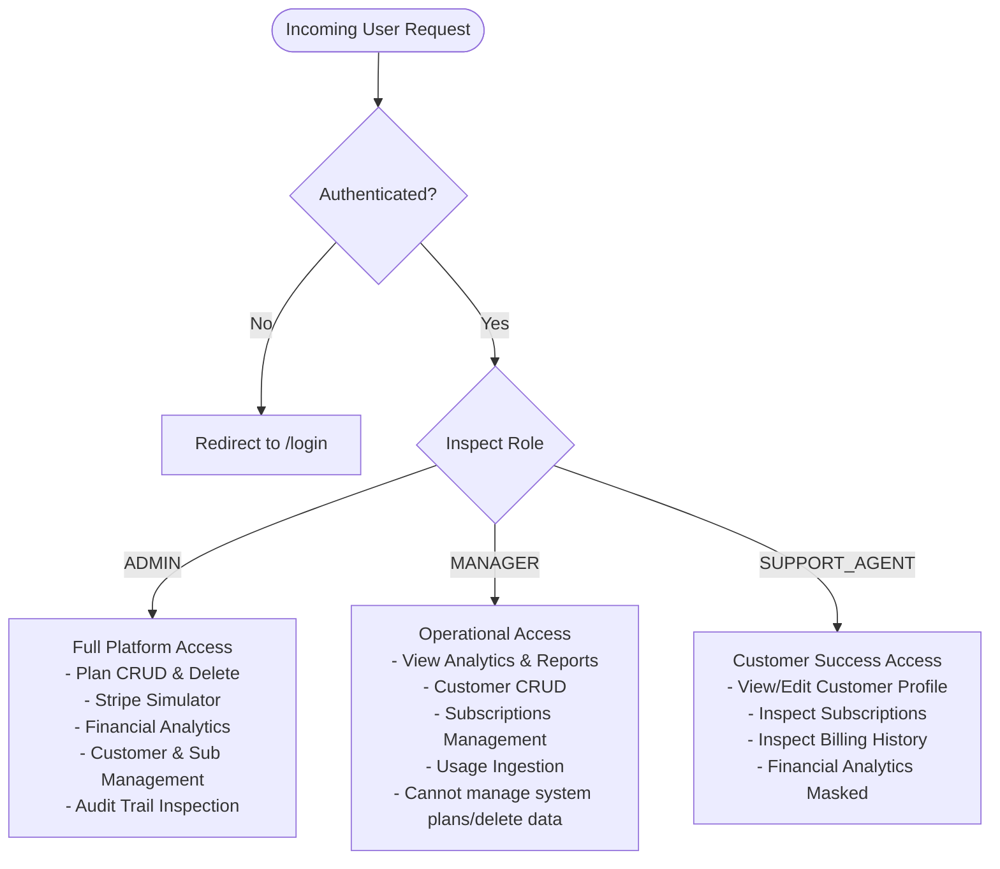

# Document 01: Problem Statement & Stakeholder Definition

**Project Name**: SubscriptIQ  
**Classification**: Enterprise Subscription Analytics & Operations SaaS Platform  
**Target Milestone**: Production-Grade SaaS MVP  

---

## 1. Business Scenario

Modern recurring revenue businesses, software-as-a-service (SaaS) startups, and digital subscription services rely heavily on granular subscription intelligence. Unlike traditional transactional retail, SaaS models depend upon multi-period retention, lifecycle expansion, contract renewals, usage tiers, and recurring billing cycles.

However, mid-market SaaS companies and high-growth engineering teams encounter significant operational fragmentation:
1. **Siloed Metric Tracking**: Founders and financial managers frequently struggle to synthesize core unit metrics—Monthly Recurring Revenue (MRR), Annual Recurring Revenue (ARR), Churn Rate, Average Revenue Per User (ARPU), and Customer Lifetime Value (LTV)—from disparate payment gateways and account systems.
2. **Subscription Lifecycle Opacity**: Transitioning subscribers through trials, upgrades, downgrades, cancellations, and past-due statuses often requires manual reconciliation, leading to revenue leakage and unaddressed involuntary churn.
3. **Usage vs. Quota Disconnect**: Resource consumption (API requests, storage volumes, seat allocations) is decoupled from billing tiers, causing unmonitored threshold breaches or missed expansion revenue.
4. **Lack of Role-Based Separation**: Support agents, managers, and system administrators often share over-privileged credentials, risking the unauthorized disclosure of executive financial projections or inadvertent deletion of critical billing entities.

**SubscriptIQ** was conceived and engineered to resolve this dilemma by establishing a centralized, unified Subscription Analytics and SaaS Management control plane.

---

## 2. Problem Definition

| Challenge Area | Root Cause | Impact on SaaS Business | SubscriptIQ Solution |
| :--- | :--- | :--- | :--- |
| **Financial Blindspots** | Inconsistent MRR/ARR definitions and manual spreadsheets | Inaccurate runway forecasts and delayed strategic pivots | Database-calculated, real-time recurring revenue formulas with historical trajectory charts |
| **Involuntary & Voluntary Churn** | Untracked payment failures and unmonitored cancellation reasons | Reduced net retention rate (NRR) and depressed valuation | Automated payment failure classification, churn analysis, and renewal tracking |
| **Quota Overages** | Disconnected infrastructure telemetry and plan thresholds | Infrastructure cost overruns without corresponding monetization | Real-time usage tracking meters with warning alerts at 80% and breach alerts at >100% |
| **Security & Governance Risks** | Absence of granular RBAC and immutable auditing | Compromised compliance, data leakage, and untraceable modifications | Strict backend-enforced RBAC (Admin, Manager, Support Agent) and tamper-proof audit trails |

---

## 3. Business Owner & Primary Stakeholders

### 3.1 Business Owner
- **SaaS Executive Leadership & Chief Financial Officer (CFO)**: Responsible for company solvency, investor reporting, unit economics, and recurring revenue growth.

### 3.2 Primary Stakeholders
1. **Product & Operations Managers**: Require visibility into plan distribution, tier velocity, customer cohort retention, and feature adoption.
2. **Customer Support & Success Specialists**: Require real-time account status, contact data, active plan details, invoice history, and quick issue remediation without seeing sensitive financial aggregates.
3. **Finance & Billing Engineers**: Require automated idempotency guards, payment failure diagnostics, invoice generation, and accurate audit trails.
4. **Prospective Investors & Board Members**: Expect standard SaaS metrics verified against actual relational transaction history.

---

## 4. User Groups & Role-Based Access Control (RBAC)

SubscriptIQ enforces strict separation of concerns across three distinct operational personas:

### Role Matrix

| Capability / Resource | Administrator (`ADMIN`) | Operations Manager (`MANAGER`) | Support Specialist (`SUPPORT_AGENT`) |
| :--- | :---: | :---: | :---: |
| **Executive Financial KPIs (MRR/ARR/Rev)** | Full Visibility | Full Visibility | Masked ("Confidential") |
| **Subscription Plan CRUD** | Read, Create, Edit, Delete | Read Only | Read Only |
| **Plan Delete Dependency Check** | Enforced | N/A | N/A |
| **Customer Management** | Full CRUD | Create, Read, Edit | Read & Edit Permitted Info |
| **Customer Deletion** | Allowed | Denied | Denied |
| **Subscription Lifecycle (Upgrade/Cancel/Renew)** | Allowed | Allowed | Read Only |
| **Resource Usage Ingestion** | Allowed | Allowed | Read Only |
| **Payment Event Simulation** | Full Simulation | Denied | Denied |
| **CSV Financial Report Export** | Allowed | Allowed | Denied |
| **Security Audit Trail Inspection** | Full Visibility | Full Visibility | Denied |

---

## 5. Project Objectives & Scope

### 5.1 In-Scope Objectives (MVP Deliverables)
1. **Robust Relational Data Layer**: Normalized PostgreSQL schema with Prisma ORM containing 8 relational models (`User`, `Customer`, `SubscriptionPlan`, `Subscription`, `UsageRecord`, `Invoice`, `BillingEvent`, `AuditLog`).
2. **Database-Driven Analytics**: Every KPI and chart is calculated directly from actual database rows via aggregate queries—no hardcoded frontend mocks.
3. **Complete Subscription Lifecycle**: Plan creation, customer assignment, monthly/annual cycles, upgrades/downgrades, non-destructive cancellations, and contract renewals.
4. **Simulated Stripe-like Payment Gateway**: Realistic mock billing events, invoice generation, refund states, payment decline classifications, and unique idempotency keys preventing duplicate charges.
5. **Telemetry & Quota Tracking**: Metering for API requests, storage (MB), active users, and transactions with automated warning triggers.
6. **Immutable Audit Trail**: Append-only event log capturing every security, administrative, and financial state modification.
7. **Production-Grade Frontend**: Next.js App Router, Tailwind CSS, Recharts visualizations, dark/light theme persistence, loading states, empty states, and toast notifications.
8. **Automated Verification**: Vitest unit and integration test suite asserting calculations, RBAC enforcement, Zod validations, and database integrity.

### 5.2 Out-of-Scope Features (Post-MVP Roadmap)
- Live production Stripe/PayPal API credential exchanges (intentionally excluded in favor of high-fidelity sandboxed simulations for safe evaluation).
- Multi-region database replication and sharding.
- Custom automated dunning email delivery via third-party SMTP.
- Public self-serve checkout storefront (focused purely on administrative and executive SaaS management).

---

## 6. Success Metrics & Key Performance Indicators

The success of the SubscriptIQ implementation is benchmarked against the following verifiable engineering standards:

1. **System Correctness**: 100% of automated tests pass without regressions across business calculations, input schema parsing, and authorization barriers.
2. **Formula Integrity**: MRR, ARR, Churn Rate, and LTV calculations match financial standard formulas across mixed monthly and annual billing cycles.
3. **Data Protection**: Zero financial metrics or audit records leaked to unauthorized support agent sessions.
4. **Idempotency Safeguard**: 100% prevention of duplicate payment events when matching idempotency keys are re-submitted.
5. **Zero-Configuration Reproducibility**: A mentor or evaluator can clone the repository, execute `npm install`, seed the database, run tests, and start the application in under 3 minutes.
