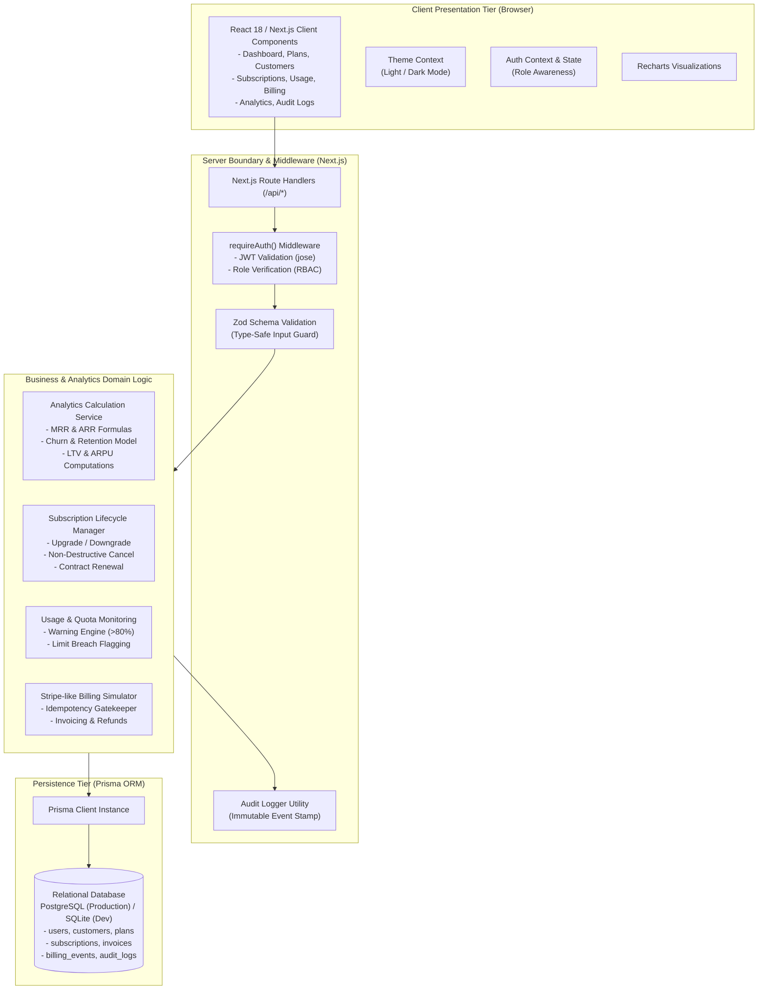
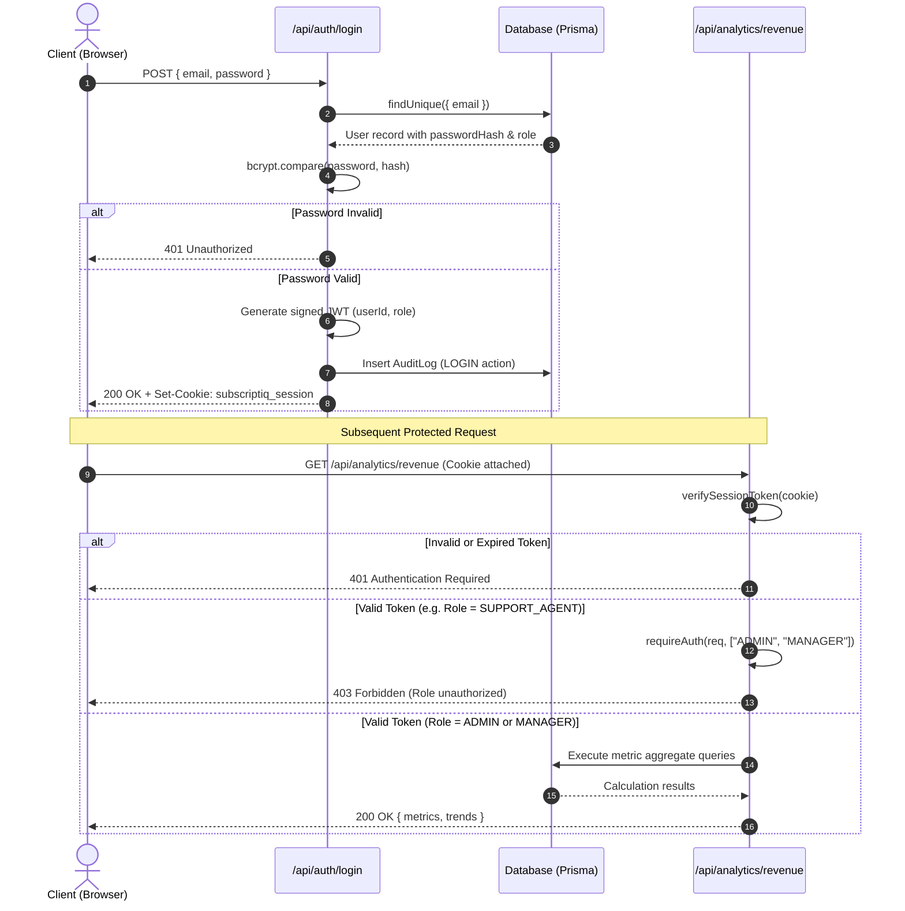

# Document 03: System Architecture Specification

**Project**: SubscriptIQ  
**Architecture Style**: Monolithic Next.js 14 App Router Full-Stack Application  
**Runtime**: Node.js v20+ with Edge-Compatible JWT Authentication  
**Data Tier**: PostgreSQL / SQLite with Prisma ORM  

---

## 1. High-Level Architecture Overview

SubscriptIQ leverages the unified Next.js 14 App Router paradigm. Server-side Route Handlers (`src/app/api/...`) function as a decoupled REST API backend, while React Server & Client components construct a responsive, theme-aware frontend dashboard.

---

## 2. Component Deconstruction

### 2.1 Client Presentation Layer
- **Framework**: Next.js 14 App Router with React 18 and TypeScript.
- **Styling**: Tailwind CSS with custom CSS variables for effortless dark and light mode transitions.
- **Iconography**: Lucide React icons delivering clean visual hierarchy.
- **Charts**: Recharts rendering declarative SVG charts (Area, Bar, Composed, and Pie) with dynamic tooltips and responsive wrappers.
- **Notifications**: Custom React Toast context delivering instant feedback on async operations without bulky external libraries.

### 2.2 API & Middleware Layer
- **REST Endpoints**: Located under `src/app/api/...`, providing standard HTTP verbs (`GET`, `POST`, `PUT`, `DELETE`).
- **Authentication**: Stateless, cryptographically signed JSON Web Tokens (JWT) signed with HMAC-SHA256 via the high-performance `jose` library, stored in secure HTTP-only cookies.
- **Authorization (RBAC)**: Centralized `requireAuth(req, allowedRoles)` guard intercepting incoming requests, checking permissions against `ROLE_PERMISSIONS`, and returning standard 401 or 403 responses.
- **Input Validation**: Strongly typed Zod schemas (`src/lib/validations.ts`) parsing request payloads before execution, preventing malformed or malicious inputs from reaching domain services.

### 2.3 Domain & Analytics Services
- **Real-Time Calculation Engine**: Rather than maintaining stale cached aggregates, metrics like MRR, ARR, and Churn are computed dynamically from actual database records across selected date ranges.
- **Idempotency Gatekeeper**: Billing events enforce an `idempotencyKey` unique database constraint. Re-submitting the same key immediately halts execution and returns HTTP 409, preventing accidental duplicate transactions.

### 2.4 Persistence Layer
- **Prisma ORM**: Provides type-safe database queries, automated relation resolution, and clean migrations.
- **Dual-Configuration Strategy**:
  - `dev.db` (SQLite): Configured out-of-the-box for zero-configuration, socket-free local development and sandboxed test execution.
  - `schema.postgresql.prisma`: Production-grade PostgreSQL schema tailored for cloud providers like Neon, Supabase, or AWS RDS.

---

## 3. Authentication & RBAC Flow

---

## 4. API Design Standards

SubscriptIQ enforces standardized RESTful principles across all endpoints:

1. **Consistent Envelope**: Responses provide clear, structured JSON objects.
2. **Deterministic HTTP Status Codes**:
   - `200 OK`: Successful retrieval or update.
   - `201 Created`: Entity successfully created.
   - `400 Bad Request`: Zod validation failed (includes field-level error messages).
   - `401 Unauthorized`: Missing or invalid session cookie.
   - `403 Forbidden`: Authenticated user lacks role permissions.
   - `404 Not Found`: Target entity ID does not exist.
   - `409 Conflict`: Business constraint breached (e.g. duplicate idempotency key or deleting a plan with active subscribers).
   - `500 Internal Server Error`: Unhandled database or system exception.
3. **Audit Hooks**: Mutating operations (`POST`, `PUT`, `DELETE`) automatically invoke `recordAuditLog` to persist a tamper-proof audit trail entry in the same cycle.

