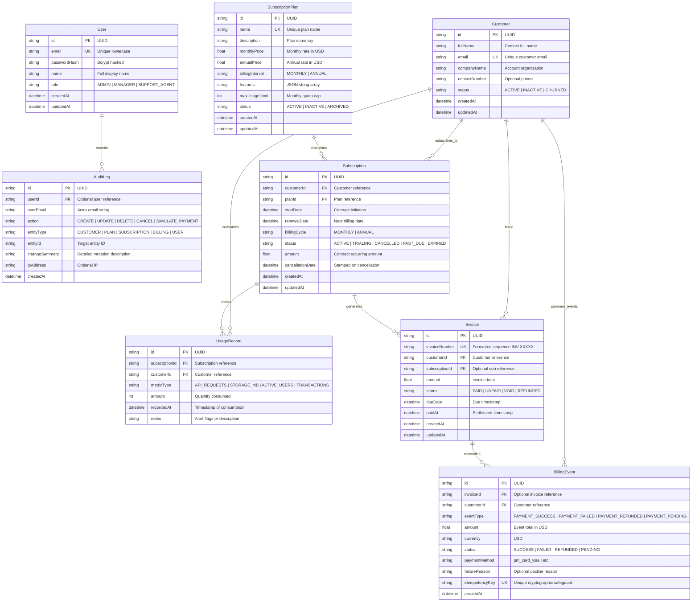

# Document 04: Database Schema Design & Entity-Relationship Model

**Database Engine**: PostgreSQL (Production) / SQLite (Local Zero-Config Development)  
**ORM**: Prisma 5.x  
**Schema File**: `prisma/schema.prisma` and `prisma/schema.postgresql.prisma`  

---

## 1. Entity-Relationship (ER) Diagram

---

## 2. Table Specifications & Constraints

### 2.1 `users`
- **Purpose**: System operators and dashboard users.
- **Constraints**:
  - `email`: `UNIQUE` constraint, indexed for fast O(1) credential lookups.
  - `role`: Restricted to `"ADMIN"`, `"MANAGER"`, `"SUPPORT_AGENT"`.

### 2.2 `customers`
- **Purpose**: SaaS subscriber accounts and company profiles.
- **Constraints**:
  - `email`: `UNIQUE` constraint preventing duplicate registrations.
  - `status`: Default `"ACTIVE"`, transitions to `"INACTIVE"` or `"CHURNED"`.

### 2.3 `subscription_plans`
- **Purpose**: Pricing catalog and resource entitlement definition.
- **Constraints**:
  - `name`: `UNIQUE` constraint preventing duplicate tier names.
  - `monthlyPrice`, `annualPrice`: Non-negative floats.
  - `maxUsageLimit`: Positive integer specifying quota ceiling.

### 2.4 `subscriptions`
- **Purpose**: Living contract between a Customer and a Plan.
- **Foreign Keys**:
  - `customerId` -> `customers(id)` (`ON DELETE CASCADE`)
  - `planId` -> `subscription_plans(id)` (`ON DELETE RESTRICT` - Enforces plan dependency check)
- **Indexes**:
  - Index on `customerId` for customer detail loading.
  - Index on `planId` for plan subscriber counting.
  - Index on `status` for active subscriber filtering.

### 2.5 `usage_records`
- **Purpose**: Telemetry logs capturing resource consumption over time.
- **Foreign Keys**:
  - `subscriptionId` -> `subscriptions(id)` (`ON DELETE CASCADE`)
  - `customerId` -> `customers(id)` (`ON DELETE CASCADE`)
- **Indexes**:
  - Composite index on `[subscriptionId, recordedAt]` for fast timeline aggregations.
  - Index on `recordedAt` for time-window queries.

### 2.6 `invoices`
- **Purpose**: Formal billing statements generated for subscriptions.
- **Constraints**:
  - `invoiceNumber`: `UNIQUE` constraint preventing duplicate invoice identifiers.
  - Foreign keys to `customers` and `subscriptions`.

### 2.7 `billing_events`
- **Purpose**: Simulated Stripe-like payment webhook events.
- **Constraints**:
  - `idempotencyKey`: `UNIQUE` constraint. Crucial safeguard preventing duplicate billing events from entering the database.
- **Indexes**:
  - Index on `customerId` for account billing history.
  - Index on `eventType` for revenue vs failure aggregations.
  - Index on `createdAt` for monthly financial timelines.

### 2.8 `audit_logs`
- **Purpose**: Append-only compliance log of administrative actions.
- **Indexes**:
  - Index on `entityType` and `action` for fast administrative filtering.
  - Index on `createdAt` for reverse-chronological event timelines.

---

## 3. Database Transactions & Data Integrity

To guarantee ACID guarantees across multi-table operations, SubscriptIQ executes coupled mutations within `prisma.$transaction`:

1. **Subscription Creation Transaction**:
   - Step 1: Create `Subscription` record.
   - Step 2: Generate initial `Invoice` with generated invoice number.
   - Step 3: Record initial `BillingEvent` (with unique idempotency key).
   - Step 4: Write `AuditLog` entry.
   - *Outcome*: If any step fails (e.g. duplicate key or DB constraint), the entire operation rolls back, preventing orphaned subscriptions without invoices.

2. **Payment Event Simulation Transaction**:
   - Step 1: Verify `idempotencyKey` uniqueness.
   - Step 2: Insert `BillingEvent`.
   - Step 3: Synchronize target `Invoice` status (`PAID`, `UNPAID`, or `REFUNDED`).
   - Step 4: Write `AuditLog` entry.
