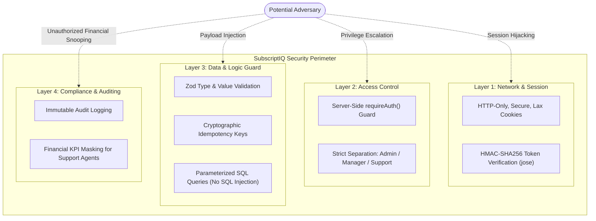

# Document 07: Security Architecture, Privacy & Risk Mitigation

**Application**: SubscriptIQ SaaS Platform  
**Compliance Baseline**: OWASP Top 10, Role-Based Access Control, Data Minimization  

---

## 1. Security Architecture & Threat Vectors

SubscriptIQ addresses the common threat vectors affecting SaaS data platforms:

---

## 2. Defensive Controls Implemented

### 2.1 Password Hashing & Storage
- **Implementation**: Plaintext passwords are never persisted or logged.
- **Algorithm**: `bcryptjs` with a work factor of 10 rounds, ensuring robust resistance against offline dictionary and rainbow-table attacks.

### 2.2 Stateless Session Management & JWT Security
- **Implementation**: Cryptographic session tokens generated via `jose` using HS256 and verified on every protected route.
- **Storage**: Persisted exclusively in HTTP-only, `SameSite=Lax` cookies, preventing cross-site scripting (XSS) scripts from reading authentication tokens.
- **Expiry**: Default 24-hour expiration prevents indefinitely stale sessions.

### 2.3 SQL Injection Elimination
- **Implementation**: No raw SQL concatenation is utilized in the application.
- **Mechanism**: Prisma ORM translates object calls into parameterized prepared statements, eliminating SQL injection vulnerabilities.

### 2.4 Server-Side Input Sanitization
- **Implementation**: Every mutation endpoint (`POST`, `PUT`) validates incoming JSON against strict Zod schemas.
- **Enforcement**: Malformed keys, negative prices, unsupported enums, or non-UUID strings are rejected before hitting the database with descriptive 400 Bad Request payloads.

### 2.5 Role-Based Data Masking
- **Governance**: Support agents need to assist customers with billing questions without having access to executive runway, MRR, ARR, and total company revenues.
- **Enforcement**: The `/api/dashboard/summary` endpoint programmatically masks financial numbers when `session.role === "SUPPORT_AGENT"`, returning `null` or `"Confidential"`.

### 2.6 Financial Duplicate Safeguard (Idempotency)
- **Problem**: Accidental double-clicks or automated payment retries can duplicate financial events.
- **Mitigation**: Every billing event requires a unique `idempotencyKey`. The database enforces a `UNIQUE` constraint; duplicate submissions trigger an HTTP 409 Conflict error and refuse duplicate creation.

---

## 3. Risk Assessment & Mitigation Matrix

| Risk Scenario | Likelihood | Impact | Severity | Mitigation Implemented |
| :--- | :---: | :---: | :---: | :--- |
| **Unauthorized Role Escalation** | Low | High | Medium | Roles are cryptographically embedded in signed JWTs and re-validated server-side on every request. |
| **Accidental Plan Deletion** | Low | High | Medium | Foreign key constraints and server-side dependency check prevent deleting plans with subscribers. |
| **Financial Data Exposure** | Medium | High | High | Support agent role masks executive metrics at the API handler level. |
| **Duplicate Invoicing** | Medium | Medium | Medium | Unique constraints on `invoiceNumber` and `idempotencyKey` prevent duplication. |
| **Compromised Audit Records** | Low | High | Medium | Audit log routes only expose `GET` methods; no `PUT` or `DELETE` endpoints exist. |
| **Real Payment Card Leakage** | N/A | Critical | Zero | The system uses mock simulated payment tokens (`pm_card_visa`), never requesting real financial credentials. |

