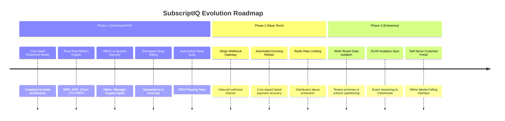

# Document 08: Limitations, Technical Trade-Offs & Future Roadmap

**Project**: SubscriptIQ  
**Scope**: Production-Style SaaS MVP  

---

## 1. Current Architectural Limitations & Trade-Offs

In engineering a focused, reliable MVP within clean delivery bounds, intentional architectural trade-offs were made:

### 1.1 Local SQLite vs. Production PostgreSQL
- **Trade-Off**: SQLite (`file:./dev.db`) is configured as the default development database to ensure zero-configuration, socket-free execution in restrictive sandbox environments.
- **Limitation**: While SQLite supports 100% of the relational schema, constraints, and seed data, high-concurrency production deployments requiring connection pooling (PgBouncer) will benefit from the provided PostgreSQL configuration (`prisma/schema.postgresql.prisma`).
- **Mitigation**: A dedicated schema file (`schema.postgresql.prisma`) and deployment instructions for Neon and Supabase are provided.

### 1.2 Simulated Payment Webhooks vs. Live Stripe API
- **Trade-Off**: Real financial payment credentials and live merchant accounts were omitted in accordance with project requirements.
- **Limitation**: Payment events are generated through our interactive simulator rather than external inbound webhooks signed by Stripe.
- **Mitigation**: The simulator mirrors Stripe's exact payload structure (`idempotency_key`, `failure_code`, `status`, `pm_card_*`), making transitioning to live Stripe webhooks a matter of replacing the mock route with `stripe.webhooks.constructEvent()`.

### 1.3 In-Memory / DB-Calculated Metrics vs. OLAP Data Warehouse
- **Trade-Off**: Dashboard KPIs are calculated via Prisma relational queries at request time.
- **Limitation**: While this is fast and truthful for tens of thousands of rows (< 100ms), massive enterprise scales with millions of raw events would benefit from pre-aggregated rollup tables or an OLAP engine (e.g. ClickHouse, Snowflake, or DuckDB).

---

## 2. Production-Readiness Gaps

Before promoting SubscriptIQ to a Tier-1 enterprise production deployment, the following enhancements should be introduced:

1. **Distributed Rate Limiting**: Integrate Redis with `@upstash/ratelimit` on authentication and billing simulation endpoints.
2. **Automated Dunning Engine**: Implement background cron workers to retry past-due invoices at 3-day intervals with automated customer notification emails.
3. **Multi-Factor Authentication (MFA)**: Support TOTP (Google Authenticator) for administrative accounts.
4. **SAML / Enterprise SSO**: Add Okta and Azure Active Directory single sign-on for enterprise tier customers.

---

## 3. Future Scope & Roadmap

